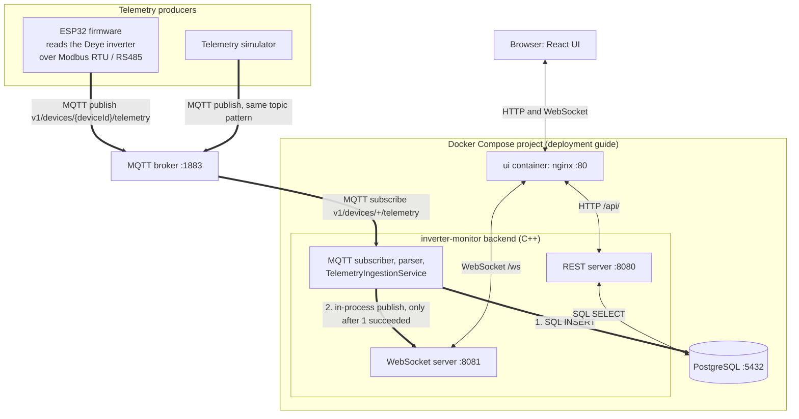

# Architecture

## System Architecture

> **Status: beta.** The diagram shows what the code and configuration in this repository do today. It does not describe a hardened or production-ready system: the UI, REST API and WebSocket have no authentication or TLS, and the repository has no production Compose file.



How to read it:

* Thick arrows are the **telemetry ingestion path**. They point in the direction the data moves.
* Thin double-headed arrows are the **UI query and update paths**: a request and its response, or a WebSocket connection that carries a subscribe message to the server and measurements back.
* The browser talks only to nginx. It never connects to MQTT, PostgreSQL, or the backend ports directly.
* The ESP32 and the simulator are separate processes that publish to the broker. The backend does not call them.

| Connection | What it represents | Evidence |
|---|---|---|
| Inverter to ESP32 | The firmware reads Deye registers with Modbus RTU function `0x03` (9600 baud, 8-N-1, slave address `1`). Read-only. | `firmware/esp32-relay/src/ModbusClient.cpp`, `firmware/esp32-relay/README.md` |
| ESP32 / simulator to broker | MQTT over plain TCP, default port `1883`. Topic `v1/devices/{deviceId}/telemetry`. The simulator uses `DEVICE_ID` (default `simulator-001`). | `firmware/esp32-relay/src/TelemetryPublisher.cpp`, `simulator/main.cpp` |
| Broker to backend | The backend subscribes to `v1/devices/+/telemetry` on `MQTT_HOST`:`MQTT_PORT`. | `backend/main.cpp` |
| Backend to PostgreSQL, step 1 | `TelemetryIngestionService::ingest()` saves the measurement through `MeasurementRepository::save()`. On failure nothing is published to WebSocket clients. | `backend/application/TelemetryIngestionService.cpp` |
| Backend to WebSocket server, step 2 | After a successful save, the same function calls the handler that runs `WebSocketServer::publish()`, inside the same process. | `backend/application/TelemetryIngestionService.cpp`, `backend/main.cpp` |
| REST server to PostgreSQL | `GET /api/v1/devices/{deviceId}/measurements` reads stored rows through `MeasurementQueryService` and `MeasurementRepository`. | `backend/api/ApiRoutes.cpp` |
| nginx to backend | `/api/` is proxied to `backend:8080`; `/ws` is proxied to `backend:8081` with the WebSocket upgrade headers. | `ui/nginx.conf` |
| Browser to nginx | The page loads the last 100 measurements over REST, then subscribes to one device over WebSocket for live updates. | `ui/src/App.tsx` |

Notes:

* A measurement is written to PostgreSQL before the WebSocket server is called. If the save fails, the measurement is not published and an error is logged. If the save succeeds but the WebSocket delivery fails, the measurement stays stored and a warning is logged.
* At startup the backend connects to PostgreSQL through libpq (the `PG*` environment variables) and applies schema migrations before it opens any port (see [Schema Migrations](#schema-migrations)).
* The Compose boundary is the layout from [Deployment](deployment.md). In that layout only the UI is published, on `127.0.0.1:8090`. Ports `8080`, `8081`, and `5432` stay on the Compose network. In development the root `compose.yaml` provides only Mosquitto and PostgreSQL (published on `1883` and `5432`), and the backend, simulator and UI run on the host, with the Vite dev server proxying `/api` and `/ws` to `127.0.0.1:8080` and `127.0.0.1:8081`.
* The MQTT broker is Mosquitto in the development `compose.yaml`. In the deployment guide it is outside the Compose project, and that guide does not specify which broker software it runs. The port is `1883` unless `MQTT_PORT` (backend, simulator) or the firmware configuration says otherwise.
* The nginx container listens on port `80`; the deployment example publishes it as `127.0.0.1:8090`.

Not implemented (not shown in the diagram):

* Authentication and TLS for the UI, REST API and WebSocket.
* MQTT over TLS in the backend, simulator and ESP32 firmware. The backend and firmware can use an MQTT user name and password, the simulator cannot, and the bundled Mosquitto configuration allows anonymous clients.
* A production Compose file in the repository.
* Write or control paths: relay control, inverter settings, and any write endpoint. The REST API and the UI are read-only.
* A device-list endpoint. The UI device ID is fixed at build time in `ui/src/deviceConfig.ts`.

## Overview

The project is a C++ backend for collecting, storing, and providing access to inverter telemetry.

The current runtime data flow is:

```text
MQTT Broker
    |
    v
mqtt::MqttClient
    |
    v
mqtt::TelemetryAdapter
    |
    v
protocol::TelemetryParser
    |
    v
application::IngestedMeasurement
    |
    v
application::TelemetryIngestionService
    |
    +--------------------------+
    |                          |
    v                          v
database::MeasurementRepository api::WebSocketServer
    |                          |
    v                          v
PostgreSQL                 WebSocket Clients
```

The backend receives telemetry through MQTT, parses incoming messages, associates measurements with a device, persists them in PostgreSQL, and publishes successfully ingested measurements to subscribed WebSocket clients.

## Main Components

### Domain

The domain layer contains core application concepts independent of infrastructure and transport details.

Main types include:

* `domain::DeviceId` — identifies an inverter or other telemetry source.
* `domain::Measurement` — represents measurement values. `pvPower`, `gridPower`, `loadPower`, and `gridVoltage` are `std::optional<double>`; `gridRelayOn` is `std::optional<bool>`. An empty value means the source did not provide it and is stored as SQL `NULL`, never as zero or `false`.

Device identification is modeled separately from measurement values.

### Protocol

The protocol layer handles the conversion of incoming telemetry payloads into application data.

`protocol::TelemetryParser` parses incoming telemetry messages and validates their contents before they enter the application layer.

Telemetry input (`schema_version` 1):

* `measured_at` (ISO 8601 UTC with 1–3 fractional digits and `Z`), `measurement.battery_power_w`, and `measurement.battery_soc_pct` are required numbers.
* `measurement.pv_power_w`, `measurement.grid_power_w`, `measurement.load_power_w`, and `measurement.grid_voltage_v` (volts) are optional numbers. `measurement.grid_relay_on` is an optional boolean: the inverter's grid relay state. They may be absent or `null`; either is treated as unavailable. A value of `0` or `false` is a value, not unavailable.
* Any present numeric field with a non-numeric value, a present `grid_relay_on` that is not a JSON boolean, or any missing required field rejects the whole message.

The simulator always sends the five power and state-of-charge fields and does not send `grid_voltage_v` or `grid_relay_on`. The ESP32 firmware publishes `grid_voltage_v` (Deye register 150) and `grid_relay_on` (register 194, bit 0) and omits a field when its register is disabled or its read fails in that cycle. Messages without these fields remain valid. In the domain, PostgreSQL (`grid_voltage`, `grid_relay_on` columns), REST, and WebSocket the fields are named `grid_voltage` and `grid_relay_on`. `grid_relay_on = false` is not by itself proof that the external grid has no voltage.

Protocol-specific parsing logic remains outside the domain layer.

### MQTT

The MQTT layer receives telemetry from the broker and forwards it into the application pipeline.

Main components include:

* `mqtt::MqttClient` — manages MQTT communication.
* `mqtt::TelemetryAdapter` — connects incoming MQTT messages to telemetry parsing and ingestion.

The expected topic format is:

```text
v1/devices/{deviceId}/telemetry
```

The device identifier is extracted from the topic and associated with the parsed measurement.

### Application

The application layer coordinates telemetry ingestion.

Main components include:

* `application::IngestedMeasurement` — combines a device identifier with a measurement.
* `application::TelemetryIngestionService` — coordinates persistence and publication of ingested telemetry.

The ingestion service uses the database repository and WebSocket server directly. The repository is currently a concrete implementation rather than an interface.

Persistence is synchronous in the ingestion path. There is no separate application-level queue or worker between MQTT message handling and database persistence.

### Database

The database layer provides PostgreSQL persistence.

`database::MeasurementRepository` encapsulates database access, including storing measurements and querying stored data.

Measurements are associated with a device identifier so that stored telemetry can be retrieved for a specific device.

#### Schema Migrations

The database schema is versioned independently of the backend version. `database::DatabaseSchema::initialize()` runs `database::MigrationRunner` with the ordered list from `database/Migrations.cpp`; on failure, `errorMessage()` describes the cause and both executables stop with that message.

* Applied versions are stored in `schema_migrations` (`version`, `name`, `applied_at`) in the connection's current schema.
* The migration list is validated before any database access: versions are positive, unique and strictly increasing; names and SQL are not empty.
* Pending migrations run in ascending order. Each migration runs in its own transaction together with its `schema_migrations` record, so a version is recorded only after its SQL succeeds. On error the transaction is rolled back and later migrations are not run.
* Each transaction takes `pg_advisory_xact_lock` with a `lock_timeout` (30 s by default) and re-reads applied versions after obtaining the lock, so concurrent backend instances apply each migration once.
* Startup fails if the database contains a version unknown to the backend (for example, a newer schema) or if the history has a gap.
* `PostgresConnection` serializes single calls, not transactions. Migrations must run before the connection is shared with other threads.

Rules for adding migrations:

* Add a new version at the end of the list; never edit or renumber an applied migration.
* Migrations are forward-only. There are no automatic rollbacks or destructive changes; restoring a previous state requires a backup.
* Migration SQL must not contain `BEGIN`/`COMMIT` or statements that cannot run inside a transaction, such as `CREATE INDEX CONCURRENTLY`.
* Versions 1–3 use `IF NOT EXISTS` so that databases created before versioning are adopted without changes to existing data. New migrations should not hide schema drift this way.

Migration tests run in a separate PostgreSQL schema per test with `search_path` set only to that schema, and drop it afterwards.

#### Startup Retry (Stage 2A)

`inverter-monitor` retries only the startup sequence "connect, then apply migrations" after a transient failure. The 60 s startup deadline is the main limit; `maxAttempts` (10) is a secondary cap. With the 1, 2, 4, 8, 10, 10… s backoff the deadline ends startup after at most 9 attempts, so logs report the attempt number and elapsed time, not "N of 10". The deadline limits the retry loop, not a single attempt: it is checked after a failed attempt (to decide whether the next one may start) and before each new attempt, and an attempt that has already started can run past it. Startup as a whole is therefore not guaranteed to finish within 60 s. Limits on a running attempt:

* `connect_timeout` (5 s by default) applies to each address of the connection separately, not necessarily to the whole connection attempt. For example, a host name that resolves to both IPv6 and IPv4 addresses can take up to 5 s per address.
* The wait for the migration advisory lock is limited by `lock_timeout` (30 s by default). The SQL of a migration has no overall timeout of its own.
* A stop signal received during a blocking libpq call does not guarantee that the current attempt ends immediately. The signal handler only sets a flag, which is checked between attempts and every 100 ms while waiting before a retry.

Error classification (`database/ErrorClassification.h`) uses structured data only, never the libpq message text:

* Permanent: invalid connection parameters, a required but missing password (`PQconnectionNeedsPassword()`), and any SQLSTATE not listed as transient.
* Transient: other connection failures, SQLSTATE class `08`, `57P01`–`57P03`, `53300`, `55P03`, `40001`, `40P01`.
* `PQconnectionUsedPassword()` is not used: it only shows that the server asked for a password, so a rejected password cannot be told apart from a refusal after successful authentication. A wrong password is therefore retried until the deadline.

Known limitation: when the execution of a migration's SQL ends with a lost connection, the cause is ambiguous (network failure, server restart, or a statement that crashes the server) and no SQLSTATE is available. It is classified as transient, so a migration that crashes the server may be retried until the deadline. A retry starts only after the previous client-side attempt has finished and its connection has been closed. That does not mean the server backend of the broken session has stopped: it may still be running the previous SQL for some time. The advisory lock only limits how long a new attempt waits for it (`lock_timeout`, a transient `55P03` on expiry); it is not a general timeout for SQL execution. Repeating the migration is safe for the schema: each migration is one transaction, and applied versions are re-read under the advisory lock, so a migration that did commit is skipped.

Retry is not added to `PostgresConnection::execute()` or other generic query methods. An INSERT whose outcome is unknown (connection lost after the request was sent) must not be repeated automatically.

### API

The API layer contains HTTP REST and WebSocket functionality.

The implemented REST functionality includes:

* `GET /api/v1/health` — health endpoint.
* `GET /api/v1/devices/{deviceId}/measurements` — query stored measurements for a device.

The WebSocket API provides real-time telemetry updates to subscribed clients.

**Current runtime status:** `inverter-monitor` starts the HTTP REST server on port `8080` and the WebSocket server on port `8081`. The HTTP server binds before the service threads start, so a bind failure is reported during startup. Both servers run in separate threads and are stopped when the process receives SIGINT or SIGTERM. `api-server` remains an API development executable; its HTTP `run()` call is disabled.

## Data Flow

### Telemetry Ingestion

1. The MQTT client receives a message from the broker.
2. The telemetry adapter extracts the device identifier from the topic.
3. The telemetry parser converts the payload into a measurement.
4. The application creates an `IngestedMeasurement` containing the device identifier and measurement.
5. The ingestion service persists the measurement in PostgreSQL.
6. After successful persistence, the ingestion service publishes the measurement to the WebSocket server.
7. The WebSocket server delivers the measurement to clients subscribed to the corresponding device.

### REST Measurement Query

The implemented REST query flow is:

1. An HTTP request identifies the device and requested measurement limit.
2. The API layer processes the request and queries the repository.
3. The repository retrieves matching measurements from PostgreSQL.
4. The API layer serializes the results into a JSON response.

The HTTP server exposes this flow from `inverter-monitor` on port `8080`.

### WebSocket Subscription

A client subscribes to a device by sending a message such as:

```json
{
  "type": "subscribe",
  "device_id": "simulator-001"
}
```

After a successful subscription, the server sends a confirmation and subsequently delivers measurements for that device.

The WebSocket server does not subscribe directly to MQTT. It receives measurements through the application ingestion flow.

## Threading and Concurrency

The MQTT client processes incoming messages through its MQTT communication path. Parsing, application ingestion, and database persistence are performed synchronously within that path.

The WebSocket server has its own Boost.Asio `io_context`, which runs in a dedicated thread.

Calls to publish measurements are posted to the WebSocket server's execution context. WebSocket session operations and session state are handled within that context.

This separation allows WebSocket communication to proceed independently of the MQTT communication path.

## Architectural Boundaries

The following boundaries should be preserved when extending the project:

* The domain layer must remain independent of infrastructure and transport details.
* Protocol parsing and MQTT-specific logic must remain outside the domain layer.
* The application layer coordinates use cases and should not contain transport-specific parsing.
* PostgreSQL access belongs in the database layer and is encapsulated by `database::MeasurementRepository`.
* WebSocket session state and network operations belong in the API layer.
* Device identifiers must be preserved throughout ingestion, persistence, and API delivery.
* Measurements should be published to WebSocket clients only after successful persistence.
* Changes should extend the existing architecture rather than introduce parallel mechanisms without a concrete need.

## Runtime Executables

### `inverter-monitor`

The main runtime executable initializes the database, repository, WebSocket server, telemetry ingestion service, and MQTT components.

It is responsible for the MQTT-to-database and MQTT-to-WebSocket telemetry flow.

The HTTP REST server is started on port `8080` in its own thread.

### `api-server`

This executable is intended for isolated API development and testing.

The HTTP server's `run()` call is currently disabled in this development executable. The production `inverter-monitor` executable starts HTTP on port `8080` and WebSocket on port `8081`.

The `inverter-monitor` executable provides the running HTTP REST endpoint.
